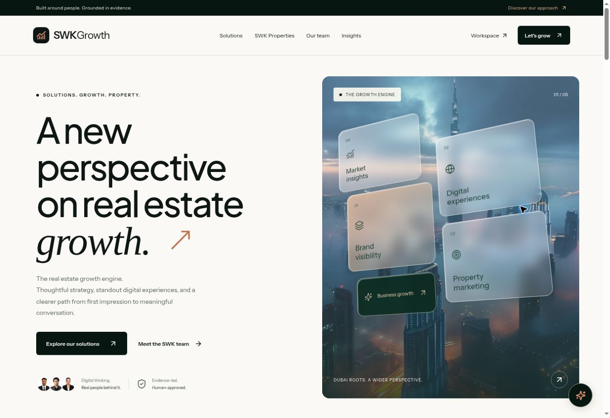

# SWKGrowth



A branded real estate growth platform concept, built from the supplied SWKGrowth brief and authentic SWK Properties assets. React 19, TypeScript, Vite, Lucide, locally served Instrument Sans and Plus Jakarta Sans.

## Run

Requires Node.js 22.12+ (or 24 LTS).

```sh
npm ci
npm run dev
npm test
npm run build
npm run preview
```

The public site is `/`; the demo workspace is `/#/app`. Hash navigation works on static hosts without route rewrites. Vercel build configuration is included. Deploy the `dist/` output on a static host, or connect this repository to Vercel. No live deployment or domain is configured by this repository.

## What works

- Responsive branded landing page with a CSS glass-block composition over source Dubai imagery; original SWKGrowth identity and unmodified SWK Properties partner logo.
- All five authentic partner portraits, exact names, titles and approved source biographies; portfolio showcase with source attribution and original property links.
- Editorial reading dialogs, proposed pricing with monthly/annual billing, consultation email preparation with consent, and a clearly labelled scripted guide with a WhatsApp handoff.
- Browser-local demo workspace: overview, clients, projects, campaigns, synthetic leads, task create/edit/complete/delete, search, status filtering, editable record details, project checklists, client associations, reporting period/metric selectors, SVG charts, widget selection and drag/keyboard reordering.
- Twelve deterministic agent templates, role-aware internal approval/rejection, source/confidence labels and a local audit trail. No external action executes on approval.
- Thirty-one city planning canvases with local persistence and text export, an illustrative ROI calculator, a source-aware property truth passport checklist, evidence ledger, criteria-based property matching, experiment backlog and what-if scenario calculator.
- Local JSON and safe CSV export, destructive-action confirmation, empty states, native modal focus trapping/Escape, semantic controls, keyboard focus and reduced-motion support.

## Scope and honesty

This is a **working frontend demo**, not a production SaaS backend. All workspace data is synthetic and browser-local. Workspace selectors are presentation filters, not tenant isolation. Role selectors and checks demonstrate approval logic and are not secure access control. There is no authentication, AI provider, CRM, live analytics, inventory feed, payments, email sending, scraping, or immutable audit service. The guide is scripted and agent drafts are deterministic templates.

Prices are proposed from the brief, not purchasable subscriptions. The brief's certification, SLA, launch-history, customer-result, market-statistic and integration claims are not repeated as facts. Property prices, availability and yields are omitted. Source-derived project records are not independently verified live listings. No guarantees of leads, sales or returns are made. Partner contact details are sourced from its repository. SWKGrowth is clearly distinguished from the real estate partner.

Before production: implement server-side authentication/authorization and tenant isolation; replace local state with a secured database; configure authorised integrations server-side; obtain current inventory, image permissions and legal/privacy review; confirm commercial terms, taxes and the production domain; perform assistive-technology and production security audits. Never put secrets in `VITE_` environment variables.

See [asset provenance](docs/ASSET-PROVENANCE.md), [implementation coverage](docs/IMPLEMENTATION.md), and [verification](docs/VERIFICATION.md).
